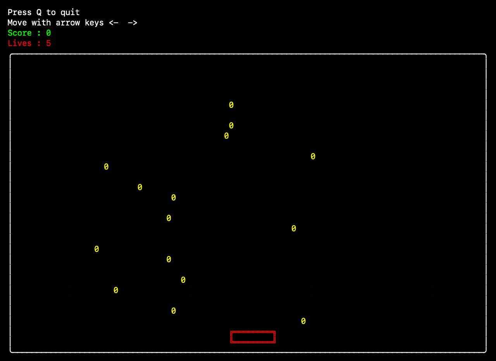

# Banana catch

---

---

#### Prerequisites
- Rust and Cargo

---

#### Setup
- clone this repo
- from the repository root, enter the `banana_drop` directory
- run `cargo build` to build or `cargo run` to start the application

---

### Controls

#### Menu
- Up and Down to select a game
- Enter to start the selected game
- Q or Esc to quit the application

#### Banana Drop
- Left and Right arrow keys to move
- Q or Esc to return to the menu
- R to restart after death

### Adding games

Each game lives in its own folder under `banana_drop/src/games`. Add the game
module and register its name, identifier, constructor, and frame handler in
`banana_drop/src/games/mod.rs` to make it available from the menu.

### Power ups (TODO)
- "_" Extend bowl
- "+" 1up
